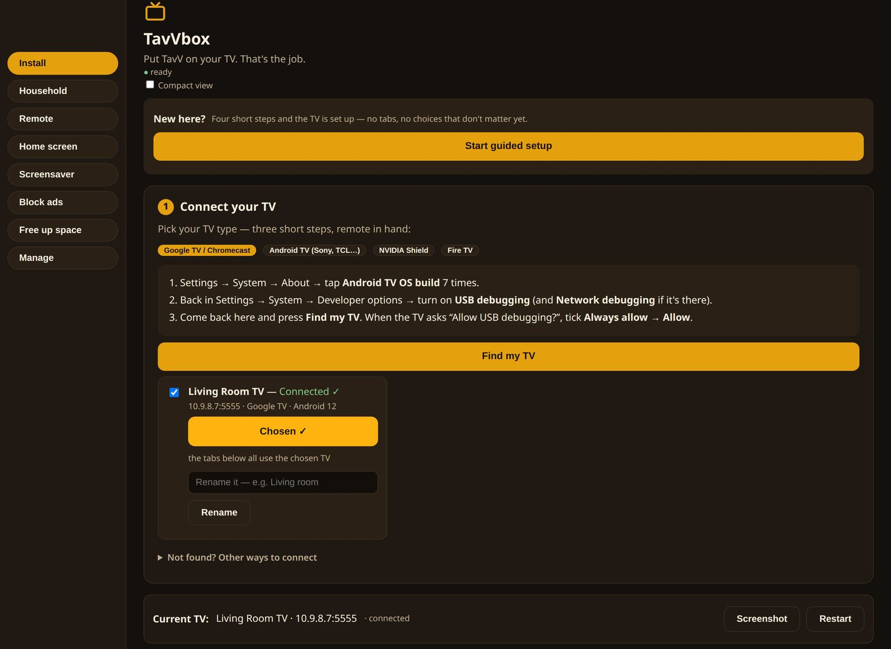
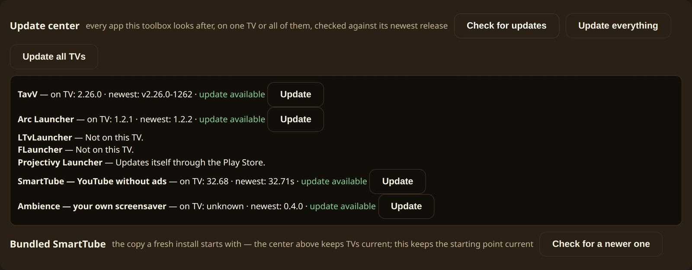
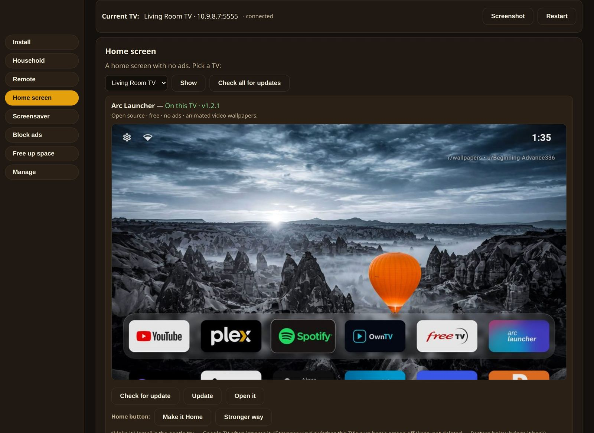
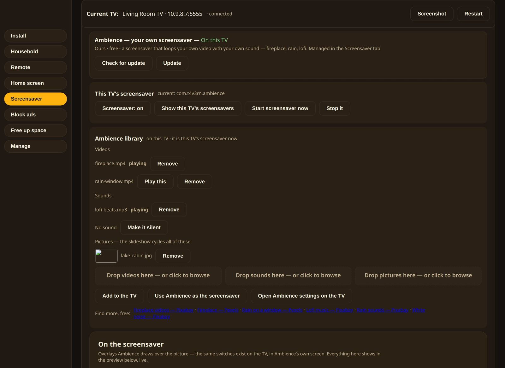
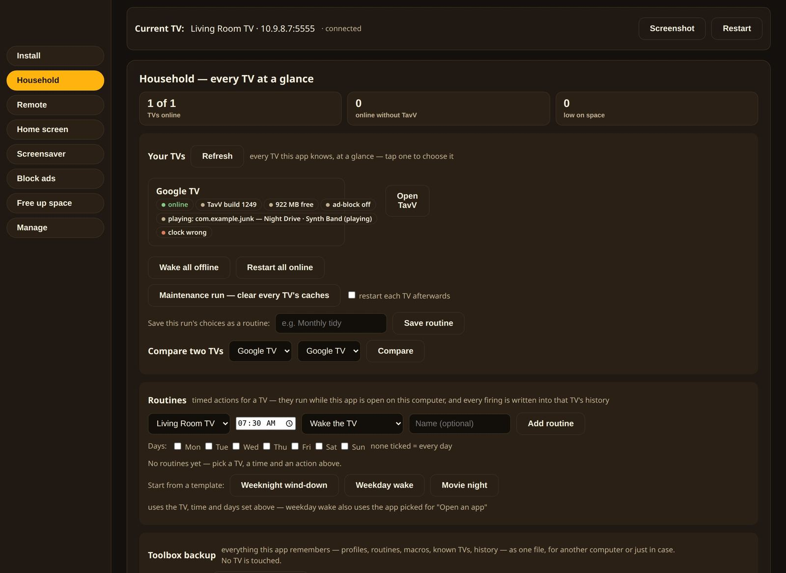
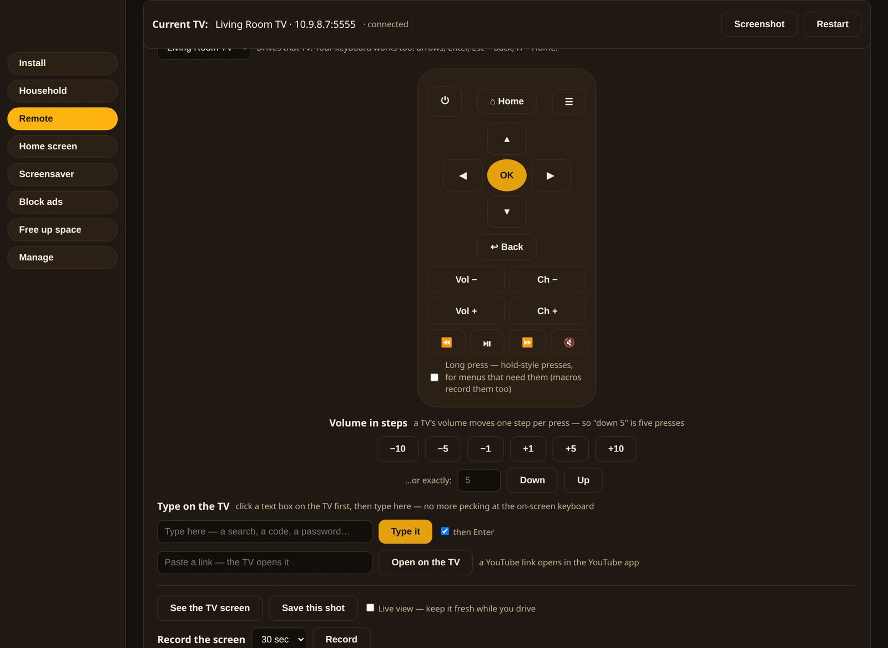

# TavVbox

**The Windows companion for your TV — it puts TavV on Android TV, Google TV and Fire TV, and looks after the set afterwards.**

TavVbox is a small Windows program that talks to your TVs over your home network (ADB, the Android debug bridge). It started as the easy way to install [TavV](https://github.com/Tr33oflife/tavv-releases) without the command line, and grew into a toolbox: installs and updates, home screens, an ad blocker, a screensaver studio, space cleanup, and a remote — all from one window, in plain language, with the TV's own answers shown before anything changes.

**Runs on:** Windows · **Manages:** Android TV · Google TV · Chromecast · Fire TV

📥 **[Download the latest release](https://github.com/Tr33oflife/tv-toolbox-releases/releases/latest)** · [All releases](https://github.com/Tr33oflife/tv-toolbox-releases/releases) · [Changelog](#changelog)

*The opening screen. The Connect card walks you through switching on debugging in three short steps; connect once and TavVbox remembers the TV. Everything else in the app works on the chosen TV.*

---

## What you need

- A **Windows PC** on the same network as the TV. Nothing is installed — unzip and run `tavvbox.exe`.
- A TV it can reach: **Android TV, Google TV, Chromecast with Google TV, or Fire TV**. (Samsung, LG and Roku sets use different systems and aren't reachable this way.)
- Five minutes with the TV remote the first time: TavVbox carries numbered, plain-language guides for turning on Developer options and Network debugging, finding the TV's address, and pairing — every step inside the app.
- No accounts, no sign-up, nothing leaves your home network. TavVbox **updates itself**: a banner offers the newest build from this repo, and the TavV inside it stays current the same way.

## What it does

### 📥 Install TavV — and other apps

The headline job. The newest TavV is **bundled in** (both processor types, checked before they're packed), so installing is: connect the TV, press Install. TavVbox works out which file your TV needs — most streamers run a 32-bit system even on a 64-bit chip, and the check goes by the TV's system, not the chip, so the right build lands the first time.

Around that: one-click installs for a small catalogue (SmartTube, the launchers below, the Ambience screensaver), drag-and-drop for your own APK files, install from a pasted link, and installs to **several TVs at once** with a step bar and a result per TV.

### 🔄 Update center — one TV, or all of them

One screen checks every app TavVbox looks after against its newest release: TavV, SmartTube, the launchers, Ambience. Update one app, update everything on the TV — or press **Update all TVs** and the whole house is done in one sweep, each TV reporting its own results and a tally at the end.

*The Update center after a check. Old → new, per app, per TV — and one button for every TV at once.*

### 🏠 Home screen

Make a different launcher the TV's home: **Arc Launcher**, **LTvLauncher** and **FLauncher** are bundled (open source, per-TV-type files included), and **Projectivy** is one tap away through the Play Store. TavVbox tries the gentle method first, reads back what the TV actually did, and only offers the stronger method after the new home is *seen working* — with a one-click restore either way. A gallery shows each launcher before you commit, and four original backgrounds are included.

*The Home screen tab: each launcher is pictured as it really looks. Arc is on this TV; Make it Home and the stronger way sit under its card.*

### 🖼️ Screensaver — Ambience

TavVbox bundles **Ambience**, a small screensaver app for the TV: a looping video (fireplace, rain on a window) with its own music track, or a photo slideshow. From the Screensaver tab you load media onto the TV, preview it in a framed-TV preview, and dress the screen up: clock and date, a caption with its own fonts (install a font file and the caption wears it) and colours, a corner title, live weather by place name, rotating quotes, and a countdown — each in whichever corner you like. There's also a photo frame that turns the TV's own screen timeout into a family slideshow, and a Start now button for testing from the sofa.

*The Screensaver tab: Ambience's library on the TV — fireplace playing, lofi beats for sound, a slideshow picture — with the settings card just below. Everything is set from the PC; the TV just plays it.*

### 🚫 Block ads & privacy

**Private DNS** is the big lever: pick a family-filtering resolver (AdGuard, Cloudflare for Families, Quad9, Control D, or your own) and many in-app ads never load. TavVbox shows the TV's setting *after* the change and undoes it in one tap. For YouTube, the honest answer is **SmartTube** (open source, bundled, kept current by the Update center) with the official app reversibly disabled. The same tab carries a **privacy switchboard**: data-collection toggles, usage-access for known tracker apps, and an ad-ID reroll — every change read back and undoable.

### 🧹 Free up space

Three tiers, safest first: a cache trim that reports space before and after; uninstall the apps *you* pick; and disable built-in bloat — disable only, never delete, with a snapshot first and a per-TV restore list. System-critical packages are hard-excluded, and anything disabled can be brought back.

### 🛋️ Household

Every TV at a glance: storage, health, what's playing. Wake or restart the whole house, run maintenance (cache trims, update checks) on a schedule with **routines**, apply saved **profiles** of settings to a TV, or **clone** one TV onto another — apps included. A change history with undo covers the settings TavVbox touches, and a TV report gathers the facts (model, system, storage, network, clock) into one file.

*The Household tab: one glance per TV, whole-house wake and restart, maintenance runs, and routines that fire on schedule.*

### 🎮 Remote & rescue

A remote pad with long-press support and recorded macros, type-on-the-TV from your PC keyboard, a live screen view, volume in steps, and a sleep timer. And **TV Rescue**: if a TV wedges, the toolbox can restart a stuck app, reset it, or walk the recovery — plus it can fetch its own copy of the Android tools if they're ever missing.

*The Remote tab: drive the TV from the PC — pad, long presses, volume in steps, and typing with a real keyboard.*

---

## Downloads

Grab the newest build from the **[Releases page](https://github.com/Tr33oflife/tv-toolbox-releases/releases)**. One ZIP, nothing to install:

| Inside the ZIP | What it is |
|---|---|
| `tavvbox.exe` | The program — run it; it opens in your browser |
| `apks/` | The bundled TavV pair (32-bit and 64-bit) |
| `launchers/` | Arc, LTvLauncher, FLauncher, SmartTube and Ambience, with their licences |
| `platform-tools/` | Google's Android tools (ADB), so there's nothing else to fetch |
| `INSTALL-WINDOWS.md` | The full guide, including what changed in every version |

Windows will warn that the program is unsigned (SmartScreen: *More info → Run anyway*) — that's expected; signing certificates cost more than this free tool can justify, and the warning is about the missing certificate, not the contents. Every release here is the build the changelog describes, and the app's own update banner pulls from this same repo.

---

## Changelog

Full notes live on each [release](https://github.com/Tr33oflife/tv-toolbox-releases/releases); the headlines:

### 0.30.32 — TavV 1262 bundled · [notes](https://github.com/Tr33oflife/tv-toolbox-releases/releases/tag/v0.30.32)

- The bundled TavV is now **build 1262 in both files** — a matched pair (the 64-bit versionCode reads 2262, as always). 1261 adds **Karaoke** (LRCLIB line-synced lyrics over your music library); 1262 fixes mouse clicks on TavV's added panels for the Windows build.

### 0.30.31 — TavV 1260 bundled · [notes](https://github.com/Tr33oflife/tv-toolbox-releases/releases/tag/v0.30.31)

- Bundled TavV **1260**, matched pair. 1259 lets Plex/Jellyfin **labels** drive custom channels; 1260 opens **Radio Browser** in full — 28 genre shelves — and carries TavV Desktop's first Windows bundle notes.

### 0.30.30 — TavV 1258 bundled · [notes](https://github.com/Tr33oflife/tv-toolbox-releases/releases/tag/v0.30.30)

- Bundled TavV **1258**, matched pair — the **Radio** build: a standalone panel in a 1930s cathedral-radio skin, 46 SomaFM stations with presets, 6 Jamendo mixes, optional Radio Browser.

### 0.30.29 — TavV 1255 bundled (32-bit) · [notes](https://github.com/Tr33oflife/tv-toolbox-releases/releases/tag/v0.30.29)

- Bundled TavV **1255** for 32-bit TVs (the 64-bit file stayed on 2249 — stated plainly, not a matched pair). 1255 adds **Guest Pass** household invites, a companion-remote Back fix, and guide-style Up Next labels.

### 0.30.28 — Update all TVs · [notes](https://github.com/Tr33oflife/tv-toolbox-releases/releases/tag/v0.30.28)

- **New: Update all TVs.** One press in the Update center checks every connected TV and installs every update going on each — TavV, SmartTube, the launchers, Ambience — with a per-TV report and a closing tally.

### Earlier versions

- **0.30.27** — TavV **1249** pair: Lofi & Chill performance pass (bundled scenes re-encoded lighter for 32-bit hardware).
- **0.30.26** — TavV **1248** pair: the real Lofi black-background fix (music and rain moved to a dedicated audio player).
- **0.30.25** — TavV **1247** pair: upstream Plezy 2.26.0 sync; everything in TavV free — the Supporter pack removed.
- **0.30.24** — TavV **1246** (32-bit) and an updater fix: the 1246 file's different name spelling (`Tavv-`) is now accepted, so the in-app update check sees the whole release.
- **0.30.19 – 0.30.23** — TavV 1240–1244 pairs in step with the TavV builds (the fit check, the episode cooldown, the Lofi background picker).
- **0.30.0** — Ambience 0.4.0: photo slideshow, widget stacking with six spots, weather by place name.
- **0.28.0** — TV Toolbox becomes **TavVbox**. Same program, same data folder — your TVs, profiles and settings carried over untouched.

---

## About this repo

This repo carries **release files only — no source code**. TavVbox is a Windows companion for [TavV](https://github.com/Tr33oflife/tavv-releases); the launchers and SmartTube it bundles are open source (their licences ride along in the ZIP), the Ambience screensaver is its own companion app, and the Android tools are Google's SDK Platform-Tools.
